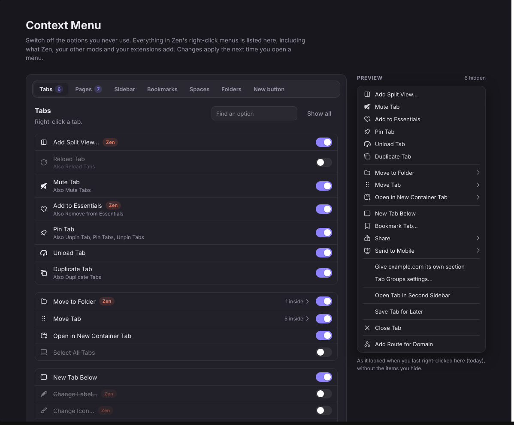

# Zen Calmer Context Menu

> [!NOTE]
> This is a fork of **Zen Context Menu** by [KiKaraage](https://github.com/KiKaraage), from the [Zen theme store](https://zen-browser.app/mods/81fcd6b3-f014-4796-988f-6c3cb3874db8) ([source](https://github.com/zen-browser/theme-store/tree/main/themes/81fcd6b3-f014-4796-988f-6c3cb3874db8), [author's repository](https://github.com/KiKaraage/ZenMods)). All credit for the mod and its idea goes to them. This fork keeps it working with current Zen releases (checked against **Zen 1.23.3b**, Firefox 158). Version 5 replaces the long list of "Hide ..." options with a settings page that can hide any item. Compared to v3.1 in the store:
>
> - The tab context menu no longer hides **Duplicate Tab** or **Move Tab** by default. Zen lists your other spaces under Move Tab, so it was the only way to move a tab to another space ([KiKaraage/ZenMods#55](https://github.com/KiKaraage/ZenMods/issues/55)).
> - Items are matched by id instead of by position, so a Zen or Firefox update no longer makes options hide the wrong items or leave separators stacked on top of each other ([KiKaraage/ZenMods#54](https://github.com/KiKaraage/ZenMods/issues/54)).
> - Options that did nothing now work: hiding **Select All Tabs** ([KiKaraage/ZenMods#63](https://github.com/KiKaraage/ZenMods/issues/63)) and **Unload Tab**, **Apply space gradient** ([KiKaraage/ZenMods#64](https://github.com/KiKaraage/ZenMods/issues/64)) and **Prioritize Copy Clean Link**.
> - **Restore icons** draws each icon in the menu's own icon slot, so icons no longer overlap labels like "Copy" ([KiKaraage/ZenMods#56](https://github.com/KiKaraage/ZenMods/issues/56)) and every icon exists in current Zen.
> - Any item can be hidden, including the ones Zen, other mods and extensions add, from a settings page with a preview of each menu.
>
> See the [changelog](CHANGELOG.md) for details.

Declutter your right click menus: switch off any option you never use, or tuck it away in a **More options** submenu, from a settings page that lists every item of every menu, including the ones Zen, your other mods and your extensions add. It can also reorder the tab context menu, put its most used actions in a row of buttons, bring back icons (Zen's, Fluent or ZenUI) or give menus your space's colors.



## What it can do

- **Hide any menu item.** The settings page lists the tab, page, sidebar, bookmark, space and folder menus and the + button's menu, the way they appear, with a switch for each item. Items inside submenus (Move Tab, Close Multiple Tabs...) can be hidden too.
- **Zen's, mods' and extensions' items included.** Items from Zen, from mods such as [Second Sidebar](https://github.com/sinazadeh/zen-second-sidebar-enhanced) and [Tab Groups](https://github.com/sinazadeh/zen-tab-groups), and from extensions such as 1Password are listed with a tag saying where they come from.
- **Preview.** Each menu is shown as it looked the last time you opened it, without the items you hide. The page menu keeps one for each kind of thing you right-clicked: a page, a link, an image, selected text...
- **No stray separators.** When you hide every item between two separators, one of them goes too, so a menu never shows two lines in a row or one at its top or bottom. This also tidies up after other mods that show or hide their items late.
- **One switch per option.** "Pin Tab" also covers "Unpin Tab" and "Pin Tabs", "Mute" covers "Unmute", and so on.
- **More options.** Options you rarely use but don't want to lose can go into a **More options** submenu at the end of their menu instead of being hidden: point at an item on the settings page and click **More**. Hold <kbd>Shift</kbd> while you right-click a tab, the sidebar or a toolbar to see the whole menu.
- **Style options:**
  - Reorder the tab context menu: tab actions first (split view, mute, Essentials, pin, unload, duplicate), then moving and organizing (folders, other spaces, containers), then everything else, then closing _(on by default)_
  - Quick actions: Reload, Pin, Add to Essentials and Bookmark as a row of buttons at the top of the tab context menu, with their names as tooltips
  - Show "Copy Clean Link" instead of "Copy Link" when it would remove tracking parameters, and only "Copy Link" when there's nothing to remove _(on by default)_
  - Hide unavailable options: the ones Zen shows greyed out, like Paste with nothing copied or Undo with nothing to undo
  - Restore icons for context menu options, like Zen had them before 1.12.9b, lined up in one column whatever padding your theme gives menu items and drawn in the color of the menu's text (so they show on dark themes that only color the labels)
  - An icon style for those icons and the quick actions: Zen's own, **Fluent** or **ZenUI**, both from [Context Menu Icons](https://github.com/Starry-AXQG/Context-Menu-Icons)
  - Hide the icons in context menus (extension items, containers...), except checkboxes and radio buttons, or draw extensions' icons in grays
  - Hide all separators, or draw them at half strength
  - Apply your space's gradient or accent color to menus, tab previews and other small pop-ups

Coming from version 4 or the theme store version? The "Hide ..." options you had on become hidden items the first time version 5 runs, so your menus stay the way they were.

## Installation

Use one copy of the mod at a time: if you have **Zen Context Menu** from Zen's mod store installed, remove it first.

### Sine

[Sine](https://github.com/CosmoCreeper/Sine) is a mod manager for Zen that can run script mods like this one.

1. Install Sine if you haven't already.
2. This mod runs JavaScript, so until it's listed in Sine's store, turn on **Enable installing JS from unofficial sources** in Sine's settings.
3. In Sine's mod manager, add a mod from a repository and enter:
   ```
   sinazadeh/zen-calmer-context-menu
   ```
4. Restart Zen.

Updating from version 4 works the same way: update the mod in Sine (with JS from unofficial sources allowed), then restart Zen. Until the script runs, the style options keep working but no items are hidden; your old choices are kept and carried over once it does.

### Manually (fx-autoconfig)

1. Set up [fx-autoconfig](https://github.com/MrOtherGuy/fx-autoconfig) in Zen.
2. Download the zip from the [latest release](https://github.com/sinazadeh/zen-calmer-context-menu/releases/latest) and copy `context-menu.uc.js` **and** the `context-menu` folder into your profile's `chrome/JS/` folder (`about:support` → Profile Folder → Open Folder).
3. For the style options, copy `chrome.css` into the `chrome` folder and add `@import "chrome.css";` at the top of `chrome/userChrome.css` (create it if needed), and set `toolkit.legacyUserProfileCustomizations.stylesheets` to `true` in `about:config`.
4. In `about:support`, click **Clear startup cache…**, then restart Zen.

Without fx-autoconfig, `chrome.css` on its own still gives you the style options (turn them on in `about:config`, using the names in [`preferences.json`](preferences.json)), but not hiding items.

### macOS

macOS draws its own context menus, which mods can't restyle. Hiding items works with them too, but the style options need Zen's menus: uncheck the first option in Sine's options for the mod (or set `widget.macos.native-context-menus` to `false` in `about:config`), and turn it back on before removing the mod. The settings page has the same switch under **Appearance**.

## Settings

Open the settings page either way:

- Right-click an empty part of the sidebar (or a toolbar) → **Customize Context Menus…**
- Click the gear button of **Zen Calmer Context Menu** in Sine's mod list.

Pick a menu at the top and switch off what you don't use. Changes apply the next time you open the menu, in every window. Not sure where to start? The page offers to hide what version 4 hid by default (Bookmark Tab and Bookmark Link, Reload Tab, Select All Tabs, Close Multiple Tabs, Search in a Private Window, Print Selection and Select All).

A few things to know:

- Extensions' items, and a few of Zen's, only exist while their menu is open. Open the menu once and they're listed.
- Items Zen hasn't shown yet are greyed out; in the tab menu they're under **Only in some situations** (pinned tabs, several selected tabs, or Firefox features Zen doesn't use).
- **Customize Context Menus…** is a menu item like any other, so you can hide it too; Sine's gear button still opens the page.
- **More** next to an item (shown when you point at it) moves it into **More options** at the end of its menu; click **In More options** to put it back. The preview shows where it went. Holding <kbd>Shift</kbd> while right-clicking shows the whole menu, for the menus Zen's own interface opens (tabs, sidebar, toolbars, bookmarks); a page's menu is opened by the page's process, which doesn't tell.
- **Icon style** picks Zen's icons, Fluent or ZenUI for **Icons for every option** and the quick actions; the list shows the picked style's icons.
- **Backup** saves the items you've hidden or moved to **More options** and your **Appearance** settings to a file (**Export settings…**), and puts them back from one (**Import settings…**), for instance in another profile or after reinstalling. Importing replaces your current choices, after asking. The macOS switch isn't included, since it's Zen's own setting.
- The hidden items are saved in `uc.hidecontext.items` and the ones in **More options** in `uc.hidecontext.folded` (lists in `about:config`), the style options as `uc.hidecontext.*` and `uc.fixcontext.*` switches, and the icon style in `uc.fixcontext.iconpack` (`zen`, `fluent` or `zenui`). What the menus showed, for the list and the preview, is kept in `zen-context-menu.json` in your profile folder.

If an item can't be hidden or an option stops doing anything after a Zen update, please [open an issue](https://github.com/sinazadeh/zen-calmer-context-menu/issues) with your Zen version (`about:support`) and the item or option's name.

## Development

There's no build step for the mod itself. `context-menu.uc.js` hides items as menus open, moves them into the quick actions and **More options**, and records what menus show; `context-menu/` holds the settings page and the code it shares with the script, and `context-menu/icons/` the Fluent and ZenUI icon styles (their style sheets are generated from `chrome.css` and `packs.json` by `node scripts/build_icon_packs.mjs`); `chrome.css` holds the style options, `preferences.json` lists them and `theme.json` is the manifest Sine reads. Every week, CI checks that everything `chrome.css` points at still exists in the latest Zen and opens the real menus in it with each option on and with items hidden. See [CONTRIBUTING.md](CONTRIBUTING.md) for the checks to run and [AGENTS.md](AGENTS.md) for how the mod is put together and how to keep it working when Zen changes.

## Credits and license

Zen Context Menu was created by [KiKaraage](https://github.com/KiKaraage) ([KiKaraage/ZenMods](https://github.com/KiKaraage/ZenMods)). This fork, Zen Calmer Context Menu, is maintained by [sinazadeh](https://github.com/sinazadeh). Both are released under the [MIT License](LICENSE).

The settings page's format (cards with switches and a live preview, opened from the mod's gear button) follows the one [oom333/zen-tab-groups](https://github.com/oom333/zen-tab-groups) made for Tab Groups.

The **Fluent** and **ZenUI** icon styles, and the ideas for the quick actions, **More options**, hiding unavailable options, gray extension icons and faint separators, come from [Context Menu Icons](https://github.com/Starry-AXQG/Context-Menu-Icons) by [Starry-AXQG](https://github.com/Starry-AXQG), released under the MIT License; its icons and license are in [`context-menu/icons`](context-menu/icons). Thank you!

[shanx/ZenMods](https://github.com/shanx/ZenMods) is another community fork of the mod, if you'd like to compare.
